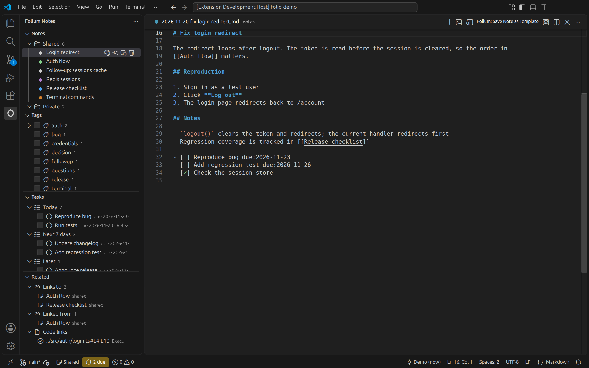
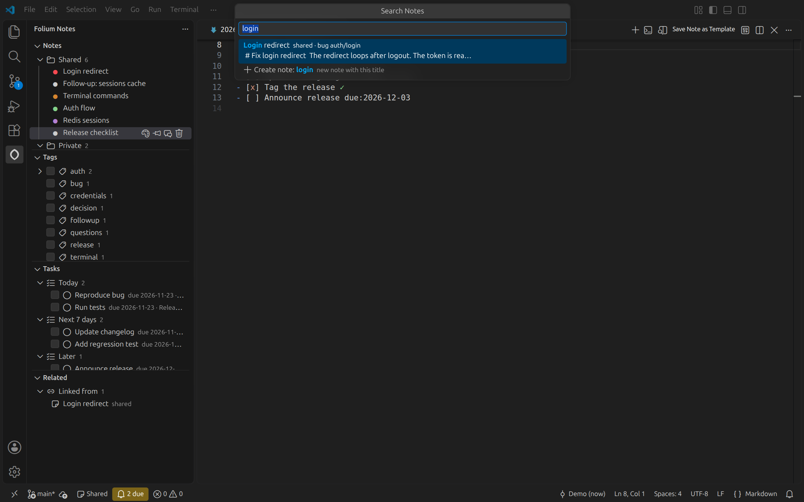
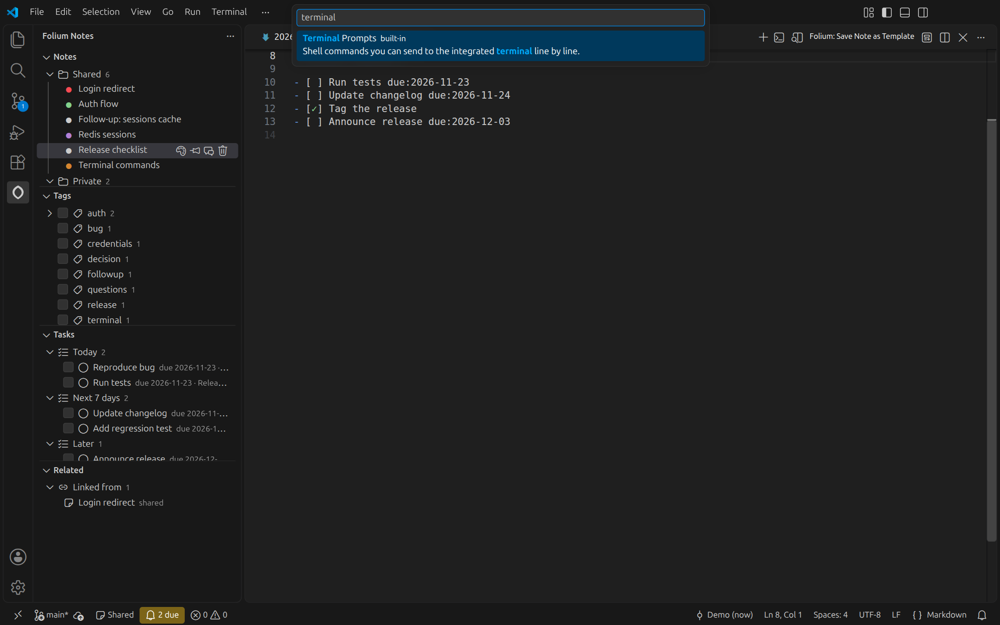
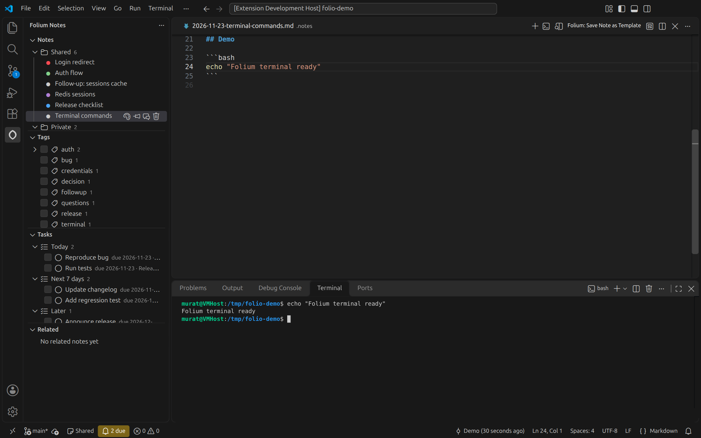
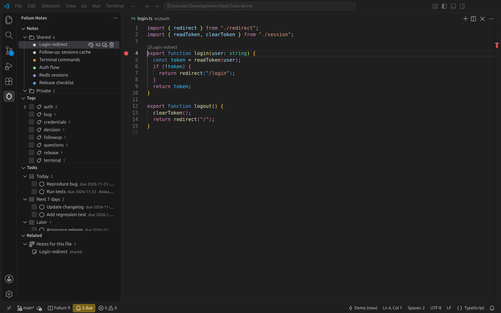
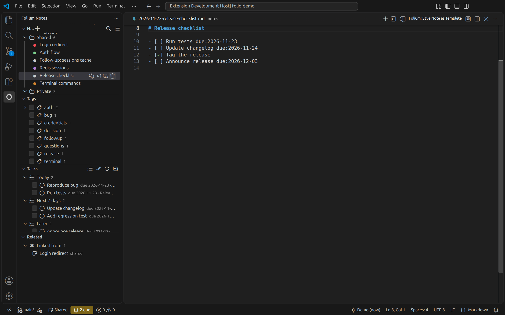
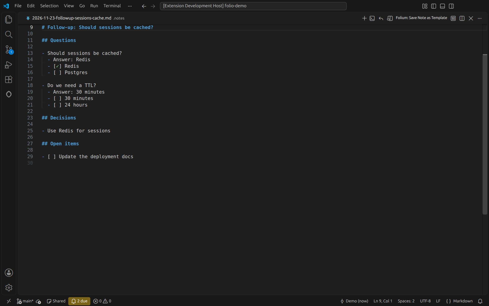

# Folium Notes — User Guide

Folium Notes keeps project notes next to the code they describe, without putting private notes in the
repository. Shared notes are ordinary Markdown files under `.notes/` in your project and are committed
with the code; private notes live outside the repository, in your home folder. Both appear in one view.

There is no account, no sync service and no telemetry. Everything is Markdown on disk, and the on-disk
format is documented in [spec/FORMAT.md](spec/FORMAT.md).

**Contents**

1. [Concepts](#1-concepts)
2. [Install and first run](#2-install-and-first-run)
3. [The interface](#3-the-interface)
4. [Creating notes](#4-creating-notes)
5. [Reading and editing notes](#5-reading-and-editing-notes)
6. [Organizing notes](#6-organizing-notes)
7. [Search](#7-search)
8. [Tags](#8-tags)
9. [Templates](#9-templates)
10. [Code links](#10-code-links)
11. [Wiki links](#11-wiki-links)
12. [Tasks](#12-tasks)
13. [Branch notes](#13-branch-notes)
14. [Working with AI](#14-working-with-ai)
15. [Encryption and sensitive notes](#15-encryption-and-sensitive-notes)
16. [Import, export, Joplin, issues and backups](#16-import-export-joplin-issues-and-backups)
17. [Remote windows](#17-remote-windows)
18. [Settings](#18-settings)
19. [Commands and keyboard shortcuts](#19-commands-and-keyboard-shortcuts)
20. [Files on disk](#20-files-on-disk)
21. [Troubleshooting](#21-troubleshooting)
22. [Privacy and security](#22-privacy-and-security)
23. [Uninstall and cleanup](#23-uninstall-and-cleanup)

---

## 1. Concepts

### Shared and private notes

| | Shared notes | Private notes |
| --- | --- | --- |
| Where | `<project>/.notes/**/*.md` | `~/FoliumNotes/<project key>/**/*.md` |
| Committed with the code | Yes | No |
| Shared with the team | Yes, through git | No |
| Setting | `foliumNotes.sharedFolder` (default `.notes`) | `foliumNotes.privateRoot` (default `~/FoliumNotes`) |

Both scopes are shown together in the Notes view and can be filtered. A note belongs to exactly one scope
and can be moved between them (sensitive notes can never become shared).

### Project key

Private notes live in a folder named after the project. The key comes from the git remote — `origin` if it
exists, otherwise the first remote — normalised to `host/path`:

| Remote | Project key |
| --- | --- |
| `git@github.com:Acme/Webapp.git` | `github.com/acme/webapp` |
| `https://gitlab.com/Group/Sub/Repo.git` | `gitlab.com/group/sub/repo` |
| `https://dev.azure.com/Contoso/Proj/_git/Repo` | `dev.azure.com/contoso/proj/repo` |
| no remote | `local/<folder>-<hash of the path>` |

The folder name replaces `/` with `_` (`github.com_acme_webapp`). Inside a sub folder of a monorepo the
relative path is appended to the key. Use `foliumNotes.privateProjectKey` to override the key, for example
when two clones must share one private folder.

### Notes are Markdown files

Every note is a `.md` file with an optional YAML header:

```markdown
---
id: 01J0ABCDEFGHJKMNPQRSTVWXYZ
title: Fix login redirect
created: 2026-11-22T14:14:05+03:00
tags: [ bug, auth/login ]
color: red
---

# Fix login redirect

The redirect loops after logout. See [[Auth flow]] and #needs-review.

- [ ] Reproduce due:2026-11-25
```

You can edit notes in VS Code, in any Markdown editor, or in git. Unknown header fields are preserved and
editing one field never rewrites the rest of the file.

---

## 2. Install and first run

### Requirements

* VS Code **1.90** or newer (desktop, or a remote window such as SSH/WSL/containers).
* A project folder. Git is optional; without a remote Folium uses a local project key.

### Install

From the Marketplace: search for **Folium Notes** and install it. From a VSIX file:

```bash
code --install-extension folium-notes-1.0.0.vsix
```

### First run

1. Open a project folder (**File → Open Folder**). Folium Notes activates automatically.
2. The **Folium Notes** icon appears in the activity bar with four views: Notes, Tags, Tasks, Related.
3. Folium creates the two note roots on demand:

```
your-project/
  .notes/                     ← created when you make your first shared note
~/FoliumNotes/
  github.com_acme_webapp/
    .Folium/project.json      ← records the project key (informational)
    .Folium/state.json        ← personal colors, pins, Joplin ids
    .Folium/trash/            ← project trash
```

4. Run **Folium: New Note** from the Command Palette, or press <kbd>Alt</kbd>+<kbd>N</kbd> then
   <kbd>N</kbd> (<kbd>Cmd</kbd>+<kbd>Alt</kbd>+<kbd>N</kbd> <kbd>N</kbd> on macOS).

Folium Notes works per workspace folder. In a multi-root workspace it uses the **first** folder in the
workspace file; open a single folder if you want notes for a different project.

---

## 3. The interface



### Notes view

Shows shared and private notes together. By default they are grouped by scope; you can group by tag
(nested), date (Today, Yesterday, This Week, This Month, Month YYYY), color or none. Pinned notes are
always on top. Every note can have a color dot, a pin, tags, open-task count, an Archive group and the
project Trash.

The title bar of the view has buttons for: new note, new from template, search, group by, sort by, filter
by tag, clear filters and refresh. Filters also cover colors (including “No color”), date presets and
custom ranges, free text and scope.

### Tags view

Nested tag tree with note counts, including parent counts. Click a tag to toggle it as a filter
(the view shows the clickable tag as active). Rename and remove tags from the context menu.

### Tasks view

Every task from every note. Group by note or by due date (Overdue, Today, Next 7 days, Later, No due
date). Tick a task in the view to write `[x]` into the Markdown file.

### Related view

Context for the active editor:

* With a note open: links to other notes, notes linking back, code links with their resolution status, and
the linked issue.
* With a code file open: notes whose code links point at the file, and the branch note for the current branch.

### Status bar

* With a note open: `$(note) Shared` / `Private` plus actions (color, pin, archive, trash, rename, encrypt,
move scope, send prompt, create issue).
* With no note open: the note count; click to search.
* A bell appears when tasks are overdue or due today; click to open the Tasks view.

### Getting started

**Folium: Getting Started** opens the walkthrough with a short tour and the same shortcuts listed below.

---

## 4. Creating notes

### New Note

Run **Folium: New Note** (<kbd>Alt</kbd>+<kbd>N</kbd> <kbd>N</kbd>) or use the **+** button in the Notes view.

1. Pick the scope if `defaultScope` is `ask` (otherwise it uses the configured scope).
2. If `defaultTemplate` is `ask`, pick a template; if it names a template, that template is used; empty
   means a blank note.
3. Enter a title. The title is stored in the `title:` header field and used for the file name.
4. Templates with questions (`{{ask:…}}`) ask them in turn.

The note is created, opened and (for templates with `{{cursor}}`) the cursor is placed where the template
says.

### Where files go and how they are named

| | Shared | Private |
| --- | --- | --- |
| Folder | `<project>/.notes/` | `~/FoliumNotes/<project key>/` |
| Example | `.notes/2026-11-22-fix-login.md` | `…/2026-11-22-credentials.md` |

Default pattern: `{date}-{slug}`. Tokens: `{date}` (`YYYY-MM-DD`), `{time}` (`HH-mm-ss`), `{slug}`,
`{id}` (the note’s ULID). The slug is lower case, accents are removed (`ı` → `i`), everything that is not
a letter or digit becomes `-`, and it is limited to 60 characters. Taken names get `-2`, `-3`; Windows
device names get an underscore (`CON` → `con_.md`). Change the pattern with `fileNamePattern`.

### New note from a code selection

1. Select code in any editor (not a note).
2. **Folium: New Note from Selection** (<kbd>Alt</kbd>+<kbd>N</kbd> <kbd>C</kbd>).
3. Choose the scope, title the note.

The note contains the selection in a fenced code block and a link back to the file and line range, and the
line range is stored in the note’s `code:` header so it can be relocated later (see §10).

### Link an existing selection to a note

**Folium: Link Selection to Note** (<kbd>Alt</kbd>+<kbd>N</kbd> <kbd>L</kbd>) appends a Markdown link such as
`[src/auth/login.ts#L3-L6](../src/auth/login.ts#L3-L6)` to a note you pick. Shared notes get a relative
path; private notes get a `file://` URI because they live outside the repository.

### Duplicate and move

* **Duplicate Note** creates a copy named “Title (copy)” in the same scope.
* **Move Note to Other Scope** moves a note and keeps its id, tags and code links. Sensitive notes cannot
  be moved to shared notes.

---

## 5. Reading and editing notes

Open a note by clicking it in the Notes view, from search, from a `[[wiki link]]`, or from a code link.
Notes are ordinary text documents: edit and save as usual. Unsaved changes are reflected immediately in
the Notes view, search and task list; closing without saving discards them as usual.

### The header fields

| Field | Meaning |
| --- | --- |
| `id` | ULID, created once; keeps colors/pins across renames |
| `title` | Display title; if absent the first body line (without `#`) or the file name is used |
| `created`, `updated` | Local ISO timestamps with UTC offset, second precision |
| `tags` | List or comma string; normalised to lower case with `/` nesting |
| `color` | `red`, `orange`, `yellow`, `green`, `blue`, `purple`, `pink`, `gray` (private notes; shared notes when `shareColors`) |
| `archived` | Date/time when archived; archived notes move to the Archive group |
| `sensitive` | Never shared, exported, published or sent to AI |
| `encrypted` | `aes-256-gcm:<fingerprint>` — see §15 |
| `code` | Code links (path, line range, captured text, end anchor) |
| `branch` | Branch note marker |
| `kind`, `target` | `prompt` / `followup`, and the AI target |
| `status`, `issue` | Free-form status and the issue URL created from the note |
| `imported_from` | Import id used to skip duplicates |

### Title and renaming

* **Rename Note** changes the `title:` field. With `renameFileOnTitleChange` (default on) the file is
  renamed to match the new title, and with `updateLinksOnRename` (default on) `[[wiki links]]` in other
  notes are updated.
* If a note has no `title:` field, the first non-empty line without leading `#` is used, then the file name.
* Renaming in the Explorer also works; Folium picks the note up again on refresh.

### Colors, pins, archive and trash

* **Color** is personal for shared notes (stored in your private `state.json`) and stored in the note itself
  for private notes. Set `shareColors` to keep shared-note colors in the file for the whole team.
* **Pin** is always personal and keeps the note on top of its group.
* **Archive** writes `archived: <date>`; archived notes are grouped separately and can be unarchived.
* **Move Note to Trash** works for shared and private notes; the file is copied into
  `…/.Folium/trash/` together with your color/pin, and the original is removed. **Restore Note from Trash**
  puts it back (or next to an existing file with a `-2` suffix). Trash entries older than
  `trashRetentionDays` (default 30) are removed automatically; `0` keeps them forever. **Empty Trash**
  deletes everything permanently.

---

## 6. Organizing notes

### Grouping and sorting

Use the view title buttons or the commands **Group Notes By…** and **Sort Notes By…**:

* Group by **scope**, **tag** (nested tag tree), **date** (Today, Yesterday, This Week, This Month, then
  one group per month), **color**, or none.
* Sort by **updated** (default), **created** or **title**, ascending or descending. Pinned notes are always
  first.
* Archived notes appear in a separate **Archive** group; deleted notes are in the view’s **Trash** group.

The choice is stored **per workspace**, not in settings, so different projects can look different.
**Reset View State** restores the defaults (sort, grouping, filters, tasks options).

### Filters

The filter buttons cover:

* **Tags** — any selected tag or all selected tags; a parent tag also matches its children.
* **Colors** — any combination, including “No color”.
* **Date** — today, last 7 days, last 30 days, this year, or a custom `YYYY-MM-DD` range (on the note’s
  updated date).
* **Text** — free-text filter using the search index.
* **Scope** — shared, private or both.

Active filters are shown in a summary line at the top of the Notes view; click it (or run **Clear Filters**)
to clear everything.

### Drag and drop and multi-select

Select one or many notes (Ctrl/Cmd+click, Shift+click) and drag them onto:

* the **Shared** or **Private** group (asks for confirmation, then moves the files),
* a **color** group (sets the color),
* a **tag** group (adds the tag),
* the **Archive** group (archives),
* the **Trash** group (asks, then moves to trash).

Tooltips show the note path, tags, task count and a text preview; screen readers get a label such as
“Fix login, shared note, red color, pinned, 2 open tasks, tags bug, auth/login”.

With `autoReveal` on, the active note is revealed in the view when you switch editors.

---

## 7. Search

**Folium: Search Notes** (<kbd>Alt</kbd>+<kbd>N</kbd> <kbd>S</kbd>) opens a live search box.



* Titles are weighted 3, tags 2 and body text 1. Every word must match somewhere.
* Prefixes match (`redir` finds “redirect”); terms longer than three characters tolerate about 20% typos.
* `#tag` tokens filter by tag, including children (`#auth` matches `auth/login`).
* Each result shows scope, tags and a snippet around the match.
* With an empty box the most recently updated notes are listed.
* Enter on “Create note: …” creates a new note with that title (you still pick the scope).

Search respects your current filter state only where filters are applied to the tree; the search box itself
searches all notes.

---

## 8. Tags

Tags come from two places:

* the `tags:` header field (list or comma-separated string), and
* inline `#hashtags` in the text, when `inlineTags` is on (default).

An inline tag starts a line or follows whitespace, must contain at least one letter, may be nested with
`/`, and is ignored inside fenced code blocks and inline code. `#123` is not a tag and `test@example.com`
is not a tag. Tags are normalised to lower case; spaces become `-` (`#Code Review` → `code-review`).

### The Tags view

* The tree is nested by `/`; a parent shows the number of notes that have it or any child.
* Click a tag (or its checkbox) to toggle it as a filter; the checkbox reflects the active state.
* Context menu: **Rename Tag Everywhere** and **Remove Tag Everywhere**.

### Rename and remove everywhere

* Renaming a tag renames it in every header and every inline occurrence, including children
  (`project/x` → `work/x` for `project` → `work`). If shared notes are affected you are asked first.
* Removing a tag removes it from headers and turns inline `#tag` into the plain word `tag`.

Use **Filter by Tag** in the palette for the same filter without opening the view.

---

## 9. Templates

### Built-in templates

| Template | Notes |
| --- | --- |
| Bug investigation | Symptoms, reproduction, expected/actual, fix checklist |
| Meeting notes | Agenda, notes, decisions, action items |
| Decision record | Context, decision, consequences, alternatives |
| Manual test prerequisites | `## Prerequisites` with a bash block, then steps |
| Credentials | No/Name/Username/Password table; **private only**, **sensitive**, encrypted automatically |
| Today I learned | Short learning capture |
| Checklist | A single checklist |
| Branch note | Branch name and a checklist for the branch |
| AI prompt | **Shared only**, `kind: prompt`; fills selection/file/language |
| Terminal Prompts | Shell commands you can send to the integrated terminal line by line |
| Other | An empty note |

Templates also apply their tags, color, `kind`, `target` and `sensitive` flag to the new note.



### Terminal Prompts and sending lines to the terminal

The **Terminal Prompts** template is a normal note containing shell commands. Put the cursor on a command
line and run **Send Line to Terminal** (<kbd>Alt</kbd>+<kbd>N</kbd> then <kbd>Enter</kbd>, the editor context
menu, the editor title action, or the status bar menu). Folium sends the line to the active integrated
terminal (creating a “Folium Notes” terminal if needed) and presses Enter.

* List markers, task checkboxes, blockquotes and shell prompts (`$`, `PS>`, `❯`) are removed first, so
  `- [ ] npm test`, `> $ npm ci` and `` `git status` `` all send correctly.
* Headings, code fence lines and empty lines are not sent; a short message explains why.
* With a multi-line selection every usable line is sent in order (fences and headings are dropped).
* The command only runs in notes, so it cannot fire while you edit code.

The **Terminal Prompts** note is a good place to keep the commands you run every day (install, build, test,
logs); no more copying and pasting between the note and the terminal.



### Team and personal templates

| Kind | Folder | Committed |
| --- | --- | --- |
| Team | `<sharedFolder>/.templates/*.md` | Yes, with the project |
| Personal | `<privateRoot>/.templates/*.md` | No, only for you |

For the same name the order is **team → personal → built-in**. A template file looks like this:

```markdown
---
template:
  name: Team bug
  description: Our bug flow
  scope: shared
  privateOnly: false
  sharedOnly: false
tags: [ bug ]
color: orange
sensitive: false
kind: prompt          # optional
target: copilot       # optional
---

# {{title}}

## Steps

{{cursor}}
```

All other header fields (`tags`, `color`, `status`, …) are copied into new notes.

### Placeholders

| Placeholder | Value |
| --- | --- |
| `{{title}}` | The note title you enter |
| `{{date}}`, `{{time}}`, `{{datetime}}` | Local date/time (`YYYY-MM-DD`, `HH:mm`) |
| `{{user}}` | `git config user.name` |
| `{{project}}` | The project key |
| `{{branch}}` | Current git branch |
| `{{ask:Question}}` | Asks you; `{{ask:Pick one|A|B}}` offers options |
| `{{cursor}}` | Where the cursor lands (only one allowed) |
| `{{selection}}` | Selected text in the last code editor (prompt templates only) |
| `{{file}}` | Relative path of the last code editor (prompt templates only) |
| `{{language}}` | Language id of the last code editor (prompt templates only) |
| `{{clipboard}}` | Clipboard text (prompt templates only) |

Template files are checked as you edit: unknown placeholders get a “Did you mean …?” suggestion, prompt-only
placeholders warn outside prompt templates, empty `{{ask:}}`, a second `{{cursor}}` and bad options are
reported. Completion is available inside `{{ }}` and hovering explains each placeholder.

### Managing templates

* **New Note from Template** / **Browse Templates** — pick a template for a scope.
* **Create Template** — creates a template file in the team or personal folder.
* **Save Note as Template** — turns the current note body into a template.
* **Manage Templates** — new note from it, preview (rendered with sample values), edit, rename, copy between
  team and personal, customize a built-in (copies it), delete.
* `defaultTemplate`: `""` (blank), `ask`, or a template name.

---

## 10. Code links

### Creating links

* **New Note from Selection** stores the selected line range in the note’s `code:` header (see §4).
* **Link Selection to Note** adds a Markdown link in the body.
* You can also write `code:` by hand; Folium fills in the snippet when you run **Update Code Links**.

```yaml
code:
  - path: ../src/auth/login.ts
    lines: 12-18
    text: |-
      export function login() {
      return redirect(url);
    endText: }
```

`path` is relative to the note for shared notes and a `file://` URI for private notes. `text` keeps the first
three non-empty lines, `endText` the last line; together they let Folium find the code again.

### How links are resolved

| Status | Meaning |
| --- | --- |
| **Exact** | The captured lines are still at the recorded range |
| **Moved** | The whole snippet was found elsewhere in the file (nearest to the old range) |
| **Moved (first line)** | Only the first captured line was found |
| **Fuzzy** | Best window with at least 75% similarity (small edits) |
| **Lost** | Nothing matched; the link is kept and flagged |

If `endText` is found further down, the range grows to include new lines. Line content is compared trimmed,
so indentation changes do not break links.

### What you see in the editor

* A **CodeLens** above the snippet with the note title (and the status when it is not exact); click it to open
  the note. Lost links show a warning lens.
* A **colored dot in the gutter**, using the note’s color (red `!` when lost).
* **Hover** on the linked lines for the note title, the captured snippet and an “Open note” link.
* The **Related** view lists every code link of the active note with its status.

Turn these off with `codeLens` and `gutterIcons`.



### Keeping links up to date

**Update Code Links** re-captures every link of a note after refactoring. It uses the current resolution —
including code that moved to another file — searches the project by file name when the old path is gone
(so file renames are followed), and rewrites the stored path and range. **Show Notes for File** lists the
notes that point at the active file.

---

## 11. Wiki links

Link notes together with `[[…]]`:

* `[[Login flow]]` — by title
* `[[2026-11-22-login-flow]]` — by file name (with or without the date prefix, with or without `.md`)
* `[[auth/2026-11-22-login-flow]]` — by relative path
* `[[01J0ABCDEFGHJKMNPQRSTVWXYZ]]` — by id
* `[[Login flow#Steps]]` — jump to a heading
* `[[Login flow|the login flow]]` — custom text

Resolution is case-insensitive inside the project and prefers notes in the same scope. Links inside code
are ignored.

* **Completion**: type `[[` for note titles, or `#` for tags.
* **Navigation**: Ctrl/Cmd+click a link (the document link is underlined); `#Heading` jumps to that heading.
* **Diagnostics**: missing notes are warnings; a shared note linking to a private note is an error.
* **Quick fix**: on a missing link, create the note in the same scope (or explicitly as a private note).
* **Backlinks**: the Related view shows notes that link to the active note.
* **Renaming**: with `updateLinksOnRename`, renaming a note updates links that used its old title/file name/path.

---

## 12. Tasks

Any Markdown task outside code is collected:

```markdown
- [ ] Reproduce the bug due:2026-11-25
* [x] Add regression test
1. [ ] Review with the team 📅 2026-12-01
```

* Due dates: `due:YYYY-MM-DD` or `📅 YYYY-MM-DD` (the token is hidden in the Tasks view).
* Buckets: **Overdue**, **Today**, **Next 7 days**, **Later**, **No due date** (local days).
* The Tasks view groups by due date or by note; **Show/Hide Done Tasks** switches completed tasks on/off.
* Ticking a task (checkbox in the view, **Toggle Task at Cursor**, or <kbd>Alt</kbd>+<kbd>N</kbd> <kbd>X</kbd>)
  rewrites only the status character in the file.
* Done tasks are shown as `[✓]` in the editor (`tasks.showCheckMarks`); the file still contains `[x]`.
* The status bar bell shows overdue and due-today tasks when `tasks.statusBar` is on.

Tasks inside fenced code blocks and inline code are ignored, so documentation examples do not become tasks.



---

## 13. Branch notes

A branch note is a normal note with `branch: <name>` in its header. One note per branch, titled
`Branch: <name>`.

| `branchNotes.onBranchSwitch` | What happens when you switch to another branch |
| --- | --- |
| `none` | Nothing |
| `notify` (default) | A notification offers to open or create the branch note |
| `open` | The existing branch note opens automatically |
| `create` | The note is created automatically |

`main`, `master`, `develop`, `dev` and `trunk` are always ignored; add more with `branchNotes.ignored`.
New notes use `branchNotes.scope` (shared by default). **Folium: Branch Note**
(<kbd>Alt</kbd>+<kbd>N</kbd> <kbd>B</kbd>) opens or creates the note for the current branch on demand.

---

## 14. Working with AI

### The rule

**AI tools cannot read your notes.** Content reaches an AI tool only when you send it from a note. Private,
sensitive and encrypted notes are never sent; for a private prompt note Folium offers to move it to shared
notes first. Sensitive notes are also never exported, published as issues or sent to Joplin.

### Prompt notes

A prompt note has `kind: prompt` (the **AI prompt** template creates one). When you run **Send Prompt**
(<kbd>Alt</kbd>+<kbd>N</kbd> <kbd>P</kbd>):

1. Placeholders are filled from the last code editor (`{{selection}}`, `{{file}}`, `{{language}}`,
   `{{clipboard}}`, plus title/date/branch).
2. Any `{{ask:…}}` questions are asked.
3. The rendered text is sent to the target — `target:` in the note, else `prompts.defaultTarget`.

| Target | How it is delivered |
| --- | --- |
| `copilot` (default) | GitHub Copilot Chat via the VS Code chat API; `prompts.submit` controls auto-send |
| `cline`, `roo`, `kilo` | Their VS Code command APIs; falls back to the clipboard |
| `continue`, `claude`, `codex`, `jetbrains` | Copied to the clipboard, with an explanation to paste |
| `custom` | A command id you set in `prompts.customCommand` (user setting, trusted workspace only) |

With `prompts.showInNotes` (default) the note records a short “Sent …” section.

**Save as Copilot Prompt File** writes the prompt to `.github/prompts/<slug>.prompt.md` with `mode: agent`,
converting `{{selection}}`/`{{file}}` to Copilot’s `${selection}`/`${file}` syntax.

### Follow-ups

A follow-up turns an AI answer into a shared note with questions, decisions and open items. Three ways to
create one:

* Copy the answer and run **Capture Follow-up from Clipboard** (<kbd>Alt</kbd>+<kbd>N</kbd> <kbd>F</kbd>).
* In VS Code, ask Copilot to use the `#followUp` tool (registered as a language model tool).
* From any MCP-capable tool, use the bundled **MCP server** (below).

The parser understands a ```` ```followup ```` YAML block, `Questions`/`Decisions` headings with lists,
`Option A:` lines and sentences ending in `?`. The note contains `- Answer:` slots and `- [ ]` options.
Fill them in and run **Send Follow-up Answers**; the reply (answers, decisions, open items) is sent to the
note’s target and the note is archived when `followUps.archiveWhenSent` is on.



### MCP server (Cline, Roo, Kilo, Copilot, JetBrains)

**Folium: Connect AI Tools** opens a page with ready-to-copy configuration. The bundled server is a
stdio MCP server exposing one tool, `create_followup_note`, which writes a JSON request into
`<privateRoot>/.inbox`; the open IDE claims it atomically and creates the note.

```json
{
  "servers": {
    "folium": {
      "command": "node",
      "args": ["<extension folder>/dist/mcp-server.js"],
      "env": {
        "FOLIUM_PRIVATE_ROOT": "/home/you/FoliumNotes",
        "FOLIUM_PROJECT": "github.com/org/repo"
      }
    }
  }
}
```

Requests are capped at 200 KB. The server never reads notes.

---

## 15. Encryption and sensitive notes

Encryption protects a note’s **content** with AES-256-GCM. The 32-byte key is stored in VS Code’s secret
storage (SecretStorage), never in the note, the repository or the backup archives. The key can be exported as
base64 text so you can use it in another IDE or machine; the fingerprint shown in the UI and in the note is
the first eight hex characters of SHA-256(key).

### Encrypting

1. Open the note and run **Encrypt Note** (also in the status bar menu and the Notes view context menu).
2. Confirm. Folium keeps the header and the title line, replaces the rest with a fenced payload and marks the
   note sensitive:

````markdown
---
id: 01J0ABCDEFGHJKMNPQRSTVWXYZ
title: Credentials
sensitive: true
encrypted: aes-256-gcm:630dcd29
---

# Credentials

```Folium-encrypted
v1.<base64 of iv | tag | ciphertext, wrapped at 76 characters>
```
````

3. On disk the body is ciphertext. In the editor the note opens decrypted through a virtual
   `folium-secure:` document; **saving re-encrypts it**. Other tools see only ciphertext.

`Decrypt Note` writes the plain Markdown back (after confirmation) and removes the `encrypted:` field; the note
stays `sensitive: true`.

### What sensitive and encrypted notes can never do

* be moved to shared notes,
* be exported (Markdown/Joplin),
* be sent to Joplin or published as an issue,
* be sent to an AI tool,
* be read by an MCP/AI tool.

The **Credentials** template is private, sensitive and encrypted automatically. With
`encryptSensitiveNotes` (a user-level setting) any note created from a sensitive template is encrypted too.

### Backing up the key

* **Back Up Encryption Key** writes a text file with comments and the base64 key. Keep it somewhere safe and
  separate from note backups.
* **Restore Encryption Key** reads such a file (comments are ignored) and stores the key. Notes encrypted with
  a different key cannot be decrypted — restore the matching key and check the fingerprint.
* Note backups deliberately **do not** contain the key.

---

## 16. Import, export, Joplin, issues and backups

### Import

**Folium: Import Notes** supports three sources and shows a preview (total, duplicates, tags) before writing:

| Source | What is imported |
| --- | --- |
| Markdown folder / Obsidian | Front matter (`tags`, `tag`, `keywords`, `created`, `date`), folders as tags, local `.md` links converted to `[[wiki links]]`, title from front matter/heading/file name |
| Joplin `.jex` | Notes with notebooks as tags, internal `:/id` links as `[[title]]`, to-dos with due dates as tasks |
| Evernote `.enex` | ENML converted to Markdown; checkboxes become tasks; Evernote tags and dates kept |

Duplicates are skipped using `imported_from` and Joplin ids. You choose the target scope before importing; the
import runs with progress reporting.

### Export

**Folium: Export Notes** writes files to a folder you choose:

* **Markdown (Obsidian)** — front matter with title/created/tags, wiki links kept.
* **Markdown (Joplin)** — front matter with title/created/updated/tags and wiki links rewritten to relative
  file links.
* Scope: shared, private or both. **Sensitive and encrypted notes are skipped** and counted in the result.
* If the target is inside the project you get a warning before writing (so exported notes are not committed by
  accident). Existing names get `-2`, `-3` suffixes.

### Send to Joplin

1. In Joplin enable the **Web Clipper** service (default `http://localhost:41184`).
2. Configure `joplin.url`; `joplin.notebook` is optional (default: the project folder name).
3. Run **Folium: Send to Joplin**. The notebook is created if needed; notes are created the first time and
   **updated by the stored Joplin id** afterwards. Sensitive/encrypted notes are never sent.

### Create an issue

Configure `issues.provider` (`github`, `gitlab` or `jira`) and the matching URLs/project key. Then run
**Create Issue from Note**:

* The title is the note title; the body is the note without its header and title.
* `[[wiki links]]` become plain text, code links become permalinks at the current commit when
  `issues.permalinks` is on.
* Tags become labels when `issues.tagsAsLabels` is on.
* Tokens are stored in VS Code secret storage (you are prompted the first time). For GitHub on
  `api.github.com`, Folium may use VS Code’s GitHub sign-in instead.
* Tokens are only sent to `github.com`, `api.github.com`, `gitlab.com` or a host you explicitly confirm. In an
  untrusted workspace project-level URLs are ignored.
* The created issue URL is stored in the note’s `issue:` field.

### Backup and restore private notes

* **Back Up Private Notes** writes a `.tar` containing `Folium-backup.json` first (format version, creation
  date, source, counts) followed by everything under the private root except `.inbox`. GNU long names are used.
* **Restore Private Notes** adds **missing** files only; files that already exist are kept and reported as
  conflicts (also written to the Folium log).
* The encryption key is not part of the backup — back it up separately.

---

## 17. Remote windows

Folium Notes runs where the files are. In a remote window (SSH, WSL, Dev Container, Codespaces) the first run
shows a one-time notice with the path of the private notes folder **on the remote machine**.

* For containers, the notice warns that a rebuild deletes the container filesystem and offers **Back Up Now**
  or **Set Private Root**.
* To keep private notes across rebuilds, point `privateRoot` at a mounted host folder (for example
  `/workspaces/.folium-notes` or a bind mount), either in user settings or via **Set Private Notes Folder**.
* Shared notes are inside the workspace, so they travel with the repository as usual.

---

## 18. Settings

All settings are under `foliumNotes.*`. Set them in **Settings** (user or workspace) or directly in
`.vscode/settings.json` so the team shares them:

```json
{
  "foliumNotes.sharedFolder": ".notes",
  "foliumNotes.defaultScope": "ask",
  "foliumNotes.defaultTemplate": "Bug investigation"
}
```

**Scopes** in the table below:

* `application` — user setting only; a workspace cannot change it (`prompts.customCommand`, `encryptSensitiveNotes`).
* `machine-overridable` — normally per machine, can be overridden per workspace (`privateRoot`, `trashRetentionDays`, `joplin.url`).
* `window` — UI/behaviour for this window (sorting defaults, task display, status bar).
* `resource` — can differ per folder in a multi-root workspace (shared folder, templates, diagnostics).

Sorting, grouping, filters and the task view options are **not settings**: they are stored per workspace and
can be restored with **Reset View State**.

<!-- settings:start -->
### Notes and storage

| Setting | Default | Scope | Description |
| --- | --- | --- | --- |
| `confirmDelete` | `true` | window | Ask before moving notes to the trash. |
| `defaultScope` | `"ask"` | window | Preselected scope (shown first, marked **default**) in the **New Note** question. The question is always asked. |
| `defaultTemplate` | `""` | resource | Template used by **New Note**: `""` blank, `ask` to choose, or a template name. |
| `fileNamePattern` | `"{date}-{slug}"` | resource | File name pattern. Tokens: `{date}`, `{time}`, `{slug}`, `{id}`. |
| `inlineTags` | `true` | resource | Read `#hashtags` from note text (outside code). |
| `privateProjectKey` | `""` | resource | Override the project key used for the private folder name. Empty = derive from the git remote. |
| `privateRoot` | `"~/FoliumNotes"` | machine-overridable | Folder for **private notes**, outside the repository. One folder per project (from the git remote) is created inside it. |
| `renameFileOnTitleChange` | `true` | resource | Rename the Markdown file when the note title changes. |
| `shareColors` | `false` | resource | Store colors of **shared notes** in the file (shared with the team) instead of personal state. |
| `sharedFolder` | `".notes"` | resource | Folder inside the project for **shared notes** (committed with the code). Default: `.notes`. |
| `trashRetentionDays` | `30` | machine-overridable | Days deleted notes stay in the project trash (0 keeps them forever). |

### View and interface

| Setting | Default | Scope | Description |
| --- | --- | --- | --- |
| `autoReveal` | `false` | window | Reveal the active note in the Notes view. |
| `defaultGroupBy` | `"scope"` | window | Initial grouping for new workspaces. |
| `defaultOrder` | `"desc"` | window | Initial sort direction for new workspaces. |
| `defaultSort` | `"updated"` | window | Initial sort order for new workspaces. |
| `statusBar` | `true` | window | Show the Folium status bar item. |
| `treeDescription` | `true` | window | Show dates or tags next to notes in the Notes view. |

### Editor integration

| Setting | Default | Scope | Description |
| --- | --- | --- | --- |
| `codeLens` | `true` | resource | Show note titles above linked code (CodeLens). |
| `gutterIcons` | `true` | resource | Show a colored dot in the gutter where a note links to code. |
| `linkDiagnostics` | `true` | resource | Warn about missing [[wiki links]] and shared notes linking to private notes. |
| `updateLinksOnRename` | `true` | resource | Update [[wiki links]] in other notes when a note is renamed. |

### Tasks

| Setting | Default | Scope | Description |
| --- | --- | --- | --- |
| `tasks.showCheckMarks` | `true` | window | Show done tasks as [✓] in the editor. |
| `tasks.statusBar` | `true` | window | Show a bell in the status bar when tasks are due or overdue. |

### Branch notes

| Setting | Default | Scope | Description |
| --- | --- | --- | --- |
| `branchNotes.ignored` | `[]` | resource | Additional branches that never get branch notes. |
| `branchNotes.onBranchSwitch` | `"notify"` | resource | What happens when the git branch changes (main/master/develop/dev/trunk are ignored). |
| `branchNotes.scope` | `"shared"` | resource | Scope of automatically created branch notes. |

### AI prompts and follow-ups

| Setting | Default | Scope | Description |
| --- | --- | --- | --- |
| `followUps.archiveWhenSent` | `true` | window | Archive follow-up notes after sending the answers. |
| `prompts.customCommand` | `""` | application | Command id used by the custom AI target (user setting only; ignored in untrusted workspaces). |
| `prompts.defaultTarget` | `"copilot"` | window | Default AI target for prompt notes. |
| `prompts.showInNotes` | `true` | window | Record sent prompts in the note. |
| `prompts.submit` | `false` | window | Submit prompts automatically where the AI API allows it. |

### Security

| Setting | Default | Scope | Description |
| --- | --- | --- | --- |
| `encryptSensitiveNotes` | `false` | application | Encrypt sensitive notes automatically (user setting only). |

### Issue trackers

| Setting | Default | Scope | Description |
| --- | --- | --- | --- |
| `issues.githubApiUrl` | `"https://api.github.com"` | resource | GitHub API base URL (api.github.com by default). |
| `issues.gitlabUrl` | `""` | resource | GitLab base URL (empty = https://gitlab.com or the remote host). |
| `issues.jira.email` | `""` | resource | Jira Cloud account email (Server PATs leave this empty). |
| `issues.jira.issueType` | `"Task"` | resource | Jira issue type name. |
| `issues.jira.projectKey` | `""` | resource | Jira project key. |
| `issues.jira.url` | `""` | resource | Jira base URL. |
| `issues.permalinks` | `true` | resource | Turn code links into permalinks at the pushed commit. |
| `issues.provider` | `""` | resource | Issue tracker used by "Create Issue from Note". |
| `issues.tagsAsLabels` | `true` | resource | Send note tags as issue labels. |

### Joplin

| Setting | Default | Scope | Description |
| --- | --- | --- | --- |
| `joplin.notebook` | `""` | resource | Joplin notebook for this project (empty = project folder name). |
| `joplin.url` | `"http://localhost:41184"` | machine-overridable | Joplin Data API URL. |
<!-- settings:end -->

---

## 19. Commands and keyboard shortcuts

The Command Palette lists every command with a **Folium:** prefix. The table below contains the
user-facing commands (internal commands used by the views are omitted).

<!-- commands:start -->
| Command | What it does |
| --- | --- |
| `folium.newNote` | New Note |
| `folium.newSharedNote` | New Shared Note |
| `folium.newPrivateNote` | New Private Note |
| `folium.newFromTemplate` | New Note from Template |
| `folium.browseTemplates` | Browse Templates |
| `folium.createTemplate` | Create Template |
| `folium.saveAsTemplate` | Save Note as Template |
| `folium.manageTemplates` | Manage Templates |
| `folium.previewTemplate` | Preview Template |
| `folium.search` | Search Notes |
| `folium.filterMenu` | Filter |
| `folium.setColor` | Set Note Color |
| `folium.togglePin` | Toggle Pin |
| `folium.archive` | Archive Note |
| `folium.unarchive` | Unarchive Note |
| `folium.renameNote` | Rename Note |
| `folium.duplicateNote` | Duplicate Note |
| `folium.moveNote` | Move Note to Other Scope |
| `folium.editTags` | Edit Note Tags |
| `folium.trashNote` | Delete Note |
| `folium.copyNoteLink` | Copy Link to Note |
| `folium.copyNotePath` | Copy Path |
| `folium.revealNote` | Reveal in File Manager |
| `folium.moveToPrivate` | Move to Private |
| `folium.moveToShared` | Move to Shared |
| `folium.linkIssue` | Link an Issue |
| `folium.restoreTrash` | Restore Note from Trash |
| `folium.emptyTrash` | Empty Trash |
| `folium.newFromSelection` | New Note from Selection |
| `folium.linkSelection` | Link Selection to Note |
| `folium.updateCodeLinks` | Update Code Links |
| `folium.showNotesForFile` | Show Notes for File |
| `folium.toggleTask` | Toggle Task at Cursor |
| `folium.showTasks` | Show Tasks |
| `folium.sendLineToTerminal` | Send Line to Terminal |
| `folium.toggleDoneTasks` | Show/Hide Done Tasks |
| `folium.tasksGroupBy` | Group Tasks By… |
| `folium.filterByTag` | Filter by Tags |
| `folium.filterByColor` | Filter by Color |
| `folium.filterByDate` | Filter by Date |
| `folium.filterByTitle` | Filter by Title |
| `folium.filterByScope` | Filter by Shared/Private |
| `folium.filterByText` | Filter by Text |
| `folium.setTagFilterMode` | Tag Filter Mode (Any/All) |
| `folium.clearFilters` | Clear Filters |
| `folium.showFilters` | Show Active Filters |
| `folium.groupBy` | Group Notes By… |
| `folium.sortBy` | Sort Notes By… |
| `folium.sortOrder` | Toggle Sort Order |
| `folium.renameTag` | Rename Tag Everywhere |
| `folium.removeTag` | Remove Tag Everywhere |
| `folium.sendPrompt` | Send Prompt |
| `folium.saveAsCopilotPrompt` | Save as Copilot Prompt File |
| `folium.captureFollowUp` | Capture Follow-up from Clipboard |
| `folium.sendAnswers` | Send Follow-up Answers |
| `folium.connectAITools` | Connect AI Tools |
| `folium.encryptNote` | Encrypt Note |
| `folium.decryptNote` | Decrypt Note |
| `folium.backupKey` | Back Up Encryption Key |
| `folium.restoreKey` | Restore Encryption Key |
| `folium.backupPrivate` | Backup Private Notes |
| `folium.restorePrivate` | Restore Private Notes from Backup |
| `folium.configurePrivateRoot` | Set Private Notes Folder |
| `folium.openPrivateFolder` | Open Private Notes Folder |
| `folium.openTemplatesFolder` | Open Templates Folder |
| `folium.openSettings` | Settings |
| `folium.resetViewState` | Reset View State |
| `folium.importNotes` | Import Notes |
| `folium.exportNotes` | Export Notes |
| `folium.sendToJoplin` | Send to Joplin |
| `folium.createIssue` | Create Issue from Note |
| `folium.branchNote` | Open Branch Note |
| `folium.newPromptNote` | New Prompt Note |
| `folium.runCommand` | Run Command in Terminal |
| `folium.copyTerminalCommand` | Copy Command |
| `folium.gettingStarted` | Get Started |
| `folium.refresh` | Refresh Notes |
| `folium.showLog` | Show Log |
<!-- commands:end -->

### Keyboard

Chords are two key presses: <kbd>Alt</kbd>+<kbd>N</kbd>, then the second key. On macOS use
<kbd>Cmd</kbd>+<kbd>Alt</kbd>+<kbd>N</kbd> as the prefix. All bindings can be changed in
**Keyboard Shortcuts**.

<!-- keybindings:start -->
| Windows / Linux | macOS | Action |
| --- | --- | --- |
| `alt+n n` | `cmd+alt+n n` | New Note |
| `alt+n t` | `cmd+alt+n t` | New Note from Template |
| `alt+n s` | `cmd+alt+n s` | Search Notes |
| `alt+n c` | `cmd+alt+n c` | New Note from Selection |
| `alt+n l` | `cmd+alt+n l` | Link Selection to Note |
| `alt+n b` | `cmd+alt+n b` | Open Branch Note |
| `alt+n p` | `cmd+alt+n p` | Send Prompt |
| `alt+n f` | `cmd+alt+n f` | Capture Follow-up from Clipboard |
| `alt+n x` | `cmd+alt+n x` | Toggle Task at Cursor |
| `alt+n enter` | `cmd+alt+n enter` | Send Line to Terminal |
<!-- keybindings:end -->

---

## 20. Files on disk

```
your-project/
  .notes/
    2026-11-22-fix-login.md
    .templates/team-bug.md
~/FoliumNotes/
  github.com_acme_webapp/
    2026-11-22-credentials.md
    .Folium/
      project.json      { "version": 1, "key": "github.com/acme/webapp", "folder": "…" }
      state.json        personal colors, pins and Joplin ids
      trash/            deleted notes (files)
      trash.json        trash index with original paths and personal data
  .templates/
    my-standup.md
  .inbox/               AI follow-up requests (never backed up)
```

`state.json` looks like this (the key is the note id, or `scope:relPath` for notes without an id):

```json
{
  "version": 1,
  "notes": {
    "01J0ABCDEFGHJKMNPQRSTVWXYZ": { "color": "red", "pinned": true },
    "shared:2026-11-22-note.md": { "color": "none", "joplinId": "…" }
  }
}
```

The exact format — including write style, code link fields, encryption payload and trash schema — is in
[spec/FORMAT.md](spec/FORMAT.md). Everything is plain text; review shared notes in pull requests like code.

---

## 21. Troubleshooting

| Symptom | What to do |
| --- | --- |
| The Notes view is empty | Check that the folder is open as the **first** workspace folder, that `sharedFolder` / `privateRoot` point at the right places, and that notes end in `.md`. Run **Folium: Refresh Notes**. |
| A note does not appear | Dot-directories are skipped except the note roots; `.templates`, `.Folium`, `.inbox` and `.git` are never scanned. Make sure the file is inside the scope root. |
| “Encryption key missing” or a note will not decrypt | Run **Restore Encryption Key** with the matching key backup. Compare the fingerprint in the note header with the one shown after restoring. |
| The key is forgotten between windows (Linux) | VS Code needs an OS keyring for persistent secrets. Without one (headless Linux, some containers) SecretStorage is per-window. Install a keyring, or restore the key from your backup in each session. |
| A code link says **Lost** | The code changed too much. Run **Update Code Links**; if the file was renamed or moved, Folium searches the project by file name. |
| A `[[link]]` is underlined as missing | Use the quick fix to create the note in the same scope, or fix the title. A shared note linking to a private note is an error by design. |
| Tasks do not show up | Tasks must be outside code and use `- [ ]`, `* [x]` or `1. [ ]`. Due dates use `due:YYYY-MM-DD` or `📅 YYYY-MM-DD`. |
| Import skips notes | Duplicates are detected by `imported_from` and Joplin id; that is expected on a second import. |
| Issue creation is disabled | The workspace is untrusted (trust it), the note is sensitive/encrypted/archived, or no provider/token is configured. |
| Joplin cannot be reached | Enable the Web Clipper service and check `joplin.url`. |
| First load of a huge project is slow | 5,000 notes take ~1.7 s to load and index on a typical machine; later refreshes are incremental (~150 ms). Search a few tens of milliseconds. |
| The view looks wrong after experimenting | **Reset View State** clears sort/group/filters for this workspace. |
| Something else | **Folium: Show Log** prints paths, counts and scan errors; the Developer Tools console shows extension errors. |

---

## 22. Privacy and security

* No telemetry, no account, no servers. Network calls happen only when you trigger AI targets, Joplin or an
  issue tracker.
* Shared notes are ordinary files in your repository; review them before committing.
* Private notes never enter the repository. Their folder is outside the project and can be moved with
  `privateRoot`.
* Sensitive notes are never shared, exported, published or sent to AI; encrypted notes keep their content
  encrypted at rest.
* Tokens live in VS Code secret storage, and issue tokens are sent only to well-known hosts or hosts you
  confirm. Untrusted workspaces run in limited mode and ignore project-level URLs/commands.
* Back up the encryption key separately from note backups.

---

## 23. Uninstall and cleanup

Uninstalling the extension leaves your notes untouched. To remove data as well:

1. Delete `<project>/.notes` if you do not want the shared notes (they may also be in git history).
2. Delete `~/FoliumNotes` to remove private notes, personal state, trash and personal templates. The AI inbox
   is inside it as well.
3. Remove the encryption key from VS Code secret storage by removing the extension/profile secrets; keep a key
   backup if you may restore encrypted notes later.

---

## Getting help

* File format and fixtures: [spec/FORMAT.md](spec/FORMAT.md)
* Architecture and limitations: [DESIGN.md](DESIGN.md)
* Issues and feature requests: use the repository’s issue tracker.
* Include the extension version, VS Code version, operating system, and the relevant part of
  **Folium: Show Log** when reporting a problem.
